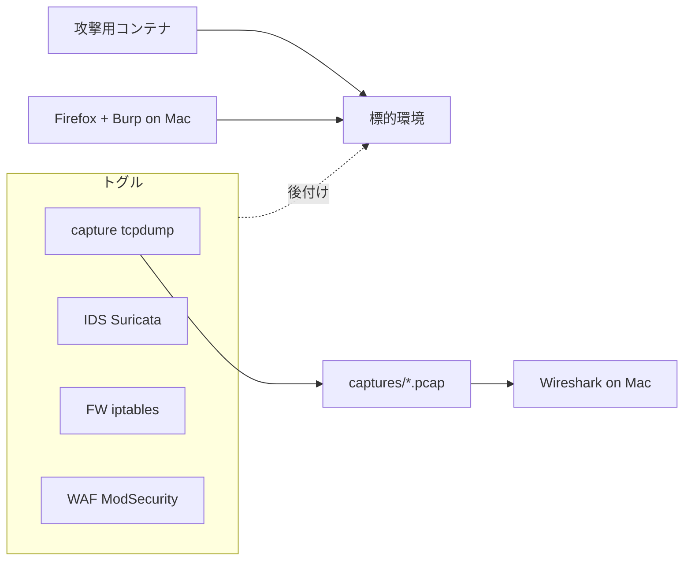

# ハッキングラボ

## 概要
- セキュリティ（攻撃・防御）をハンズオン形式で学ぶ個人用リポジトリ
- 目的：情報処理安全確保支援士の対策
- ローカルに脆弱なネットワーク／Webシステムを構築し、攻撃 → 対策 → 再攻撃で確認、を繰り返す

## 設計方針：標的＋トグル
環境を2層で考え、数を絞る。
- **標的（ターゲット環境）**… 攻撃される側。似たトポロジ・ツールのテーマは1環境に集約する。
- **トグル（横断機能）**… どの標的にも後付けできる観測・防御。プロファイルや Make ターゲットでオン/オフする。

標的は1つずつ起動し、脆弱版/対策版はページ内モードや FW トグルで切り替える。約30テーマ → 標的5〜6個＋トグル数個に圧縮している。

## 構成

```
hacking-labo/
├── Makefile                 # make up/capture/ids/fw-on LAB=<分野>/<環境>
├── common/attacker/         # 攻撃用コンテナ（Kali、全環境共通）
├── labs/
│   ├── network/playground/  # 偵察・盗聴・ARP・DNS・FW・TLS-MITM（+capture/ids/fwトグル）
│   ├── web/webapp/          # Web脆弱性ぜんぶ＋web認証（+WAFトグル、ページ内 vuln/fixed）
│   ├── analysis/            # パスワード解析＋フォレンジック（オフライン解析）
│   ├── mail/                # SPF/DKIM/DMARC・オープンリレー
│   ├── auth/keycloak/       # OAuth/OIDC
│   ├── secure-coding/       # C（BOF・競合・整数オーバーフロー）
│   └── container/           # コンテナ脱出・クラウド設定ミス（VM内で実施）
├── scenarios/corp-network/  # 総合シナリオ（playground+webapp+mail+トグルの合成）
├── captures/                # pcap・解析成果物（git管理外）
└── docs/                    # README以外のドキュメント（ROADMAP・用語・法規・午後問題の振り返り）
```



## 環境
- Mac（M1 / 16GB）+ OrbStack + Docker Compose
- ラボは1つずつ起動する
- 隔離が必要なラボ（コンテナ脱出など）は OrbStack の Linux 仮想マシン内で行う
- ポートは `127.0.0.1` にのみ公開

## 技術スタック

| 区分 | 技術 |
|---|---|
| Mac | Wireshark, Burp Suite Community, Firefox |
| 攻撃側 | Kali（nmap, tcpdump, arpspoof, mitmproxy, hydra, John the Ripper, hashcat, sqlmap, ffuf, openssl, swaks）, Python |
| Webアプリ | Go（net/http, html/template）, SQLite / MySQL, nginx, 一部 PHP |
| ネットワーク | vsftpd, telnetd, OpenSSH, BIND9, Squid, Postfix + OpenDKIM, WireGuard, iptables, fail2ban |
| 認証・PKI | Keycloak, JWT, OpenSSL（自前CA） |
| 防御・検知 | ModSecurity + OWASP CRS, Suricata, rsyslog + Loki + Grafana |
| 解析 | Volatility 3, The Sleuth Kit, gdb |

## 標的環境の一覧

状態：構築済 → 環境が動く / 学習済 → 攻撃と対策を一通り実施

| 環境 | パス | カバーするテーマ | 状態 |
|---|---|---|---|
| ネットワーク演習場 | `network/playground` | 偵察、盗聴、ARP、DNS、FW、TLS-MITM | 構築済（偵察・盗聴・FW・IDS・DNS動作確認済／ARP・TLS-MITMは手順記載） |
| Webアプリ | `web/webapp` | SQLi, XSS, OSコマンド, パストラバーサル, SSRF, リダイレクト, CORS, CSRF, セッション固定, JWT, 総当たり, XXE(PHP) ＋ WAFトグル | 構築済（11ページ＋WAF） |
| PKI/TLS | `crypto/pki` | 自前CA、証明書検証とMITM、電子署名 | 構築済（検証有無でMITM成否・署名の改ざん検知を確認済） |
| 検知基盤 | `detection` | 軽量SIEM（Loki+Grafana+Promtail）、LogQLで総当たり検知 | 構築済（LogQLで検知・Grafana可視化を確認済） |
| 解析 | `analysis/password-crack`, `analysis/forensics` | パスワード解析、フォレンジック（pcap/C2発見） | 構築済（パスワード解析・ネットワークフォレンジック）／メモリ・ディスクは任意 |
| メール | `mail` | なりすまし → SPF/DKIM/DMARC、オープンリレー | 構築済（オープンリレー・SPF動作確認済／DKIMは解説） |
| OAuth/OIDC | `auth` | redirect_uri/state/PKCE/IDトークン検証の不備（軽量自作IdP+RP） | 構築済（4種の不備を vuln/fixed で確認済） |
| セキュアコーディング | `secure-coding` | BOF（認証バイパス・カナリア）、整数/符号検査（C） | 構築済（BOF・整数検査・カナリア動作確認済／競合状態は追加予定） |
| コンテナ/クラウド | `container` | 特権/権限の設定ミス比較（安全）、脱出手順はVM内、クラウド設定ミス | 構築済（特権vsハードニング比較／脱出・クラウドは手順記載） |
| 総合シナリオ | `scenarios/corp-network` | 外部/DMZ/内部をFW分離、侵入→ピボット→検知→対応 | 構築済（分離の到達性確認済／攻撃筋書きは手順） |

トグル：capture（pcap記録）／ids（Suricata）／fw-on,fw-off（iptables）／waf（ModSecurity, webapp）

進捗・残作業・拡充候補は [docs/ROADMAP.md](docs/ROADMAP.md) にまとめている。

保留：Windows / Active Directory

## クイックスタート
```sh
make attacker                          # 攻撃用コンテナをビルド（初回のみ）
make list                              # 環境一覧
make up      LAB=network/playground    # 起動
make shell   LAB=network/playground    # 攻撃用コンテナに入る
make capture LAB=network/playground    # トグル: 通信をpcap記録
make ids     LAB=network/playground    # トグル: IDS(Suricata)
make fw-on   LAB=network/playground    # トグル: 標的のFW有効化
make down    LAB=network/playground    # 停止・削除
```
各環境の手順は、環境内の `README.md` を参照。
