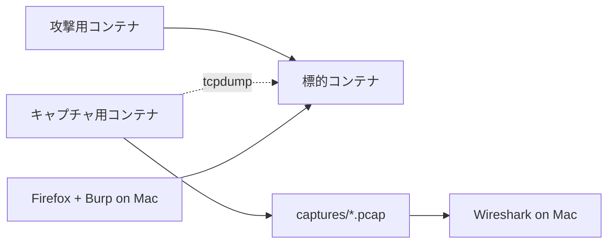

# ハッキングラボ

## 概要
- セキュリティ（攻撃・防御）をハンズオン形式で学ぶ個人用リポジトリ
- 目的：情報処理安全確保支援士の対策
- ローカルに脆弱なネットワーク／Webシステムを構築し、攻撃 → 対策 → 再攻撃で確認、を繰り返す

## 進め方
1. 単元ラボで個々の攻撃と対策を学ぶ（1テーマ1環境、必要なものだけ起動）
2. 総合シナリオ環境で、企業ネットワーク全体を対象に侵入〜検知〜対応を通しで行う

各ラボは `vulnerable/`（脆弱版）と `fixed/`（対策版）を持つ。

## 構成

```
hacking-labo/
├── Makefile                 # make up LAB=web/01-sqli など
├── common/attacker/         # 攻撃用コンテナ（Kali）
├── labs/<分野>/<番号-テーマ>/
│   ├── README.md            # 目的 / 攻撃 / 対策 / 試験での問われ方
│   ├── compose.yml
│   ├── vulnerable/
│   └── fixed/
├── scenarios/corp-network/  # 総合シナリオ（外部 / DMZ / 内部）
├── captures/                # pcap（git管理外）
└── notes/                   # 用語・法規・午後問題の振り返り
```



## 環境
- Mac（M1 / 16GB）+ OrbStack + Docker Compose
- ラボは1つずつ起動する
- 隔離が必要なラボ（コンテナ脱出など）は OrbStack の Linux 仮想マシン内で行う
- ポートは `127.0.0.1` にのみ公開

## 技術スタック

| 区分 | 技術 |
|---|---|
| Mac | Wireshark, Burp Suite Community, Firefox |
| 攻撃側 | Kali（nmap, tcpdump, arpspoof, mitmproxy, hydra, John the Ripper, hashcat, sqlmap, ffuf, openssl, swaks）, Python |
| Webアプリ | Go（net/http, html/template）, SQLite / MySQL, nginx, 一部 PHP |
| ネットワーク | vsftpd, telnetd, OpenSSH, BIND9, Squid, Postfix + OpenDKIM, WireGuard, iptables, fail2ban |
| 認証・PKI | Keycloak, JWT, OpenSSL（自前CA） |
| 防御・検知 | ModSecurity + OWASP CRS, Suricata, rsyslog + Loki + Grafana |
| 解析 | Volatility 3, The Sleuth Kit, gdb |

## ラボ一覧（実施順）

状態：構築済 → 環境が動く / 学習済 → 攻撃と対策を一通り実施

| # | 分野 | 内容 | 状態 |
|---|---|---|---|
| 1 | network | 偵察（nmap）、盗聴（FTP/Telnet/HTTP → Wireshark） | 構築済 |
| 2 | crypto | パスワード解析（John/hashcat）、ハッシュとソルト | 未 |
| 3 | web | SQLi, XSS, CSRF, SSRF, OSコマンドインジェクション, パストラバーサル, XXE, オープンリダイレクト, CORS, WAF | 未 |
| 4 | crypto / auth | 自前CAでTLS、証明書未検証のMITM、総当たり・パスワードリスト攻撃、セッション固定、JWT改ざん、OAuth/OIDC | 未 |
| 5 | network | ARPスプーフィング、DNS、FW設計（iptables）、VPN | 未 |
| 6 | mail | なりすまし → SPF/DKIM/DMARC、オープンリレー | 未 |
| 7 | detection | Suricata、ログ収集・分析 | 未 |
| 8 | scenario | 総合シナリオ環境（侵入 → 検知 → 対応） | 未 |
| 9 | forensics | pcapからC2通信の発見、ログ追跡、メモリ解析 | 未 |
| 10 | secure-coding | バッファオーバーフロー、競合状態、整数オーバーフロー（C） | 未 |
| 11 | container | 特権コンテナからの脱出、クラウド設定ミス | 未 |

※ #1 は `01-recon` と `02-sniffing` の2ラボを用意。

保留：Windows / Active Directory

## クイックスタート
```sh
make attacker                      # 攻撃用コンテナをビルド（初回のみ）
make list                          # ラボ一覧
make up   LAB=network/01-recon     # 起動
make shell LAB=network/01-recon    # 攻撃用コンテナに入る
make down LAB=network/01-recon     # 停止・削除
```
各ラボの手順は、ラボ内の `README.md` を参照。
