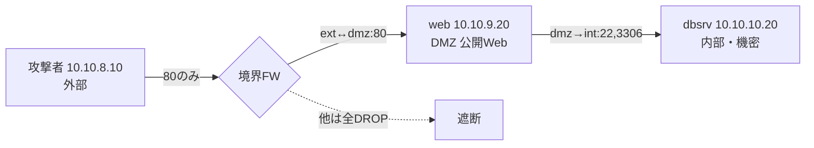

# scenarios/corp-network — 総合シナリオ（侵入 → 検知 → 対応）

外部／DMZ／内部の3セグメントを境界FWで分離した企業ネットワーク。これまでの単元で学んだ攻撃・対策を、全体構成の中で通しで考える（支援士 午後試験の「構成図を読む」形式に対応）。

## ネットワーク構成


| セグメント | ホスト | IP | 役割 |
|---|---|---|---|
| 外部 (10.10.8.0/24) | attacker | .10 | 攻撃者（Kali） |
| 境界 | fw | 各.2 | ルータ＋iptables |
| DMZ (10.10.9.0/24) | web | .20 | 公開Web（侵入の入口）+ SSH |
| 内部 (10.10.10.0/24) | dbsrv | .20 | 機密ファイル `/root/crown-jewels.txt` |

### FWポリシー（最小許可）
- 外部 → DMZ: **Web(80) のみ**
- DMZ(web) → 内部: **SSH(22)/DB(3306) のみ**
- それ以外（外部→内部、内部→外部 など）は既定で **DROP**

## 起動（Makefile外。直接 compose）
```sh
cd scenarios/corp-network
docker compose -p hl-scenario up -d --build
docker compose -p hl-scenario exec attacker bash
```
トグル:
```sh
docker compose -p hl-scenario --profile capture up -d capture   # DMZの通信を記録
docker compose -p hl-scenario --profile ids     up -d ids       # SuricataでDMZ監視
```

## 演習A: セグメント分離の確認（到達性マトリクス）
**目的**: 攻撃者の位置（外部）から各セグメントへの到達性を実際に測り、境界FWが意図通り「最小許可（外部→DMZは80だけ、他はDROP）」に設計できているかを検証する。設計図と実挙動が一致するかを確かめる演習。
```sh
# 攻撃者から
curl -m5 http://10.10.9.20/         # DMZ Web → 到達(200)
nc -w3 -z 10.10.10.20 22            # 内部SSH → 遮断
nc -w3 -z 10.10.9.20 22             # DMZ SSH → 遮断（80以外は不可）
```
| 経路 | 結果 |
|---|---|
| 攻撃者→Web:80 | 到達 |
| 攻撃者→内部:22 / Web:22 | 遮断 |
| Web→内部:22 | 到達（業務許可） |
| 内部→外部 | 遮断（持ち出し経路なし） |

## 演習B: 攻撃の筋書き（侵入→ピボット→持ち出し）
**目的**: 「外部からは1つのポートしか見えない」状態から、攻撃者がどうやって最奥の機密（内部DBサーバ）まで到達するかを一連の流れで追う。FWが塞いでいても、**業務のために開けた許可（DMZ→内部のSSH）を踏み台にして奥へ進める**ことを体感する。

1. **偵察**: 攻撃者からは Web(80) しか見えない（nmap）。演習Aで確認した通り。
2. **侵入**: web(10.10.9.20) の脆弱性（SQLi/コマンドインジェクション等。`web/webapp` で練習した手法）で DMZ に足場を得る。
3. **ピボット**: DMZ の web から内部 `dbsrv:22` へ（FWが業務用に許可している経路を利用）。`ssh svc@10.10.10.20`。アカウント `svc` / パスワード `Passw0rd!` は dbsrv に設定済みの弱い認証情報（`node/Dockerfile` で作成）。
4. **目標**: 内部 dbsrv の `/root/crown-jewels.txt`（中身は `FLAG{crown-jewels-customer-db}`、compose.yml の `SECRET` で投入）を取得する。内部→外部は直接遮断されているため、攻撃者は持ち出しを **DMZ Web を経由して**外へ戻す必要がある。
※ 実際の攻撃コマンドは各自この環境内で実施。

## 演習C: 検知と対応（defender視点）
**目的**: 演習Bの攻撃を守る側として観測し、どの段階でどう検知できるか、そして「どこを締めていれば防げたか」を構成図に立ち返って考える（午後試験の対策設問に対応）。
- 上記トグル（`--profile capture` / `--profile ids`）で capture / ids を有効化し、攻撃時の通信・アラートを確認。
- `captures/scenario/` の pcap・`eve.json` を解析（[[analysis/forensics]] の手法）。
- 「どこを締めれば防げたか」を考える: Webの脆弱性修正、DMZ→内部の許可最小化、WAF/IDS、内部からの外向き通信制限、ログ監視。

## 試験での問われ方
- ゾーニング（DMZ/内部）、FWのフィルタリング設計、多層防御
- 侵入経路・攻撃シナリオの読解、影響範囲の特定
- 検知（IDS/ログ）とインシデント対応の流れ
- 持ち出し（exfiltration）経路の遮断、egressフィルタリング

## 後片付け
```sh
docker compose -p hl-scenario --profile capture --profile ids down -v
```
